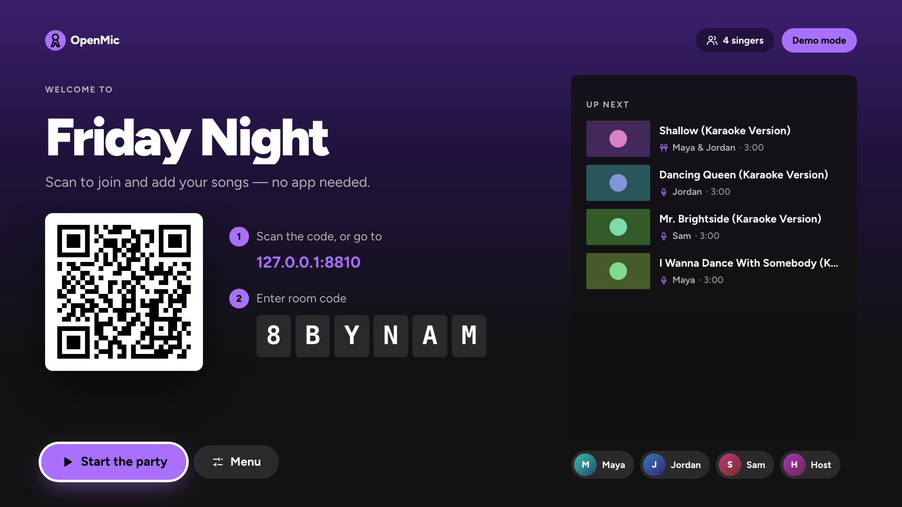
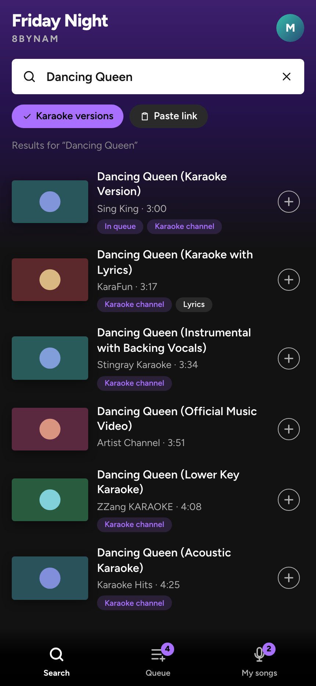
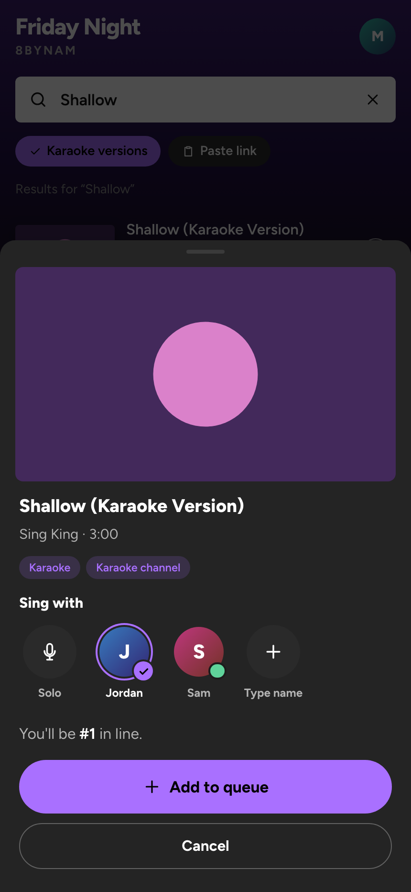
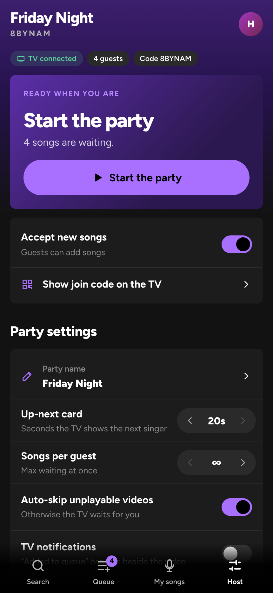
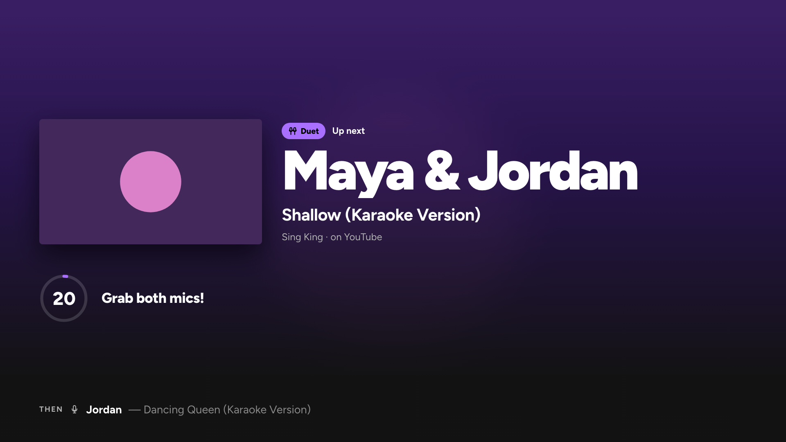

# OpenMic

**Your TV is the stage. Your phone is the songbook.**

A self-hosted karaoke system for house parties. Guests scan a QR code on the TV, pick a name, and queue YouTube
karaoke videos from their phones — no app install, no accounts. The Fire TV plays songs in strict
first-come, first-served order, shows an "Up next" card for each singer, and the host runs the
show from their phone or the Fire TV remote.

[Quick start](#try-it-on-your-computer-5-minutes) · [Deployment](docs/deployment.md) ·
[Fire TV setup](docs/fire-tv.md) · [Architecture](docs/architecture.md)



## From the couch to the chorus

- **Scan, join, sing.** Guests use their phone browser; no downloads or sign-ups.
- **Find your version.** Search YouTube karaoke videos or paste a link.
- **Bring a duet partner.** Sing with another guest or add a friend who doesn't have a phone.
- **Keep the party moving.** A shared live queue, singer announcements, and automatic playback.
- **Host from anywhere in the room.** Run the show from your phone or the Fire TV remote.
- **Make it yours.** Run on your home network or your own server with HTTPS.

## A look around

| Find your song | Make it a duet | Run the party |
|:---:|:---:|:---:|
|  |  |  |

**A moment in the spotlight.** The TV announces each singer before playback — including both
names for a duet.



Screenshots show the real app running with the offline demo catalog. Song results and artwork
are sample data; demo mode does not play real YouTube videos.

## How it fits together

```
 Phones (browser)  ──HTTPS/WSS──►  Party server (FastAPI + Postgres)  ◄──WSS──  Fire TV app
 join · search · queue · host        owns the queue & party state             owns playback
                                                                              (official YouTube
                                                                               IFrame player)
```

| Part | Where | What it is |
|---|---|---|
| Party server | [services/api](services/api) | FastAPI, SQLAlchemy, Alembic, WebSockets |
| Web app | [apps/web](apps/web) | SvelteKit: guest, host, admin **and the TV screen** (`/tv`) |
| Fire TV app | [apps/fire-tv](apps/fire-tv) | Kotlin shell (85 KB APK) around the `/tv` page |
| Deployment | [infrastructure](infrastructure) | Docker Compose: Caddy (HTTPS), API, Postgres, nightly backups |
| Docs | [docs](docs) | Architecture, deployment, Fire TV, YouTube notes, design decisions |

## Try it on your computer (5 minutes)

Requirements: Python 3.12+ with [uv](https://docs.astral.sh/uv/), Node 20.19+ or 22.12+.

```bash
git clone https://github.com/DuffyAdams/OpenMic.git
cd OpenMic
cp services/api/.env.example services/api/.env   # optional: add YOUTUBE_API_KEY to enable search
./scripts/dev.sh
```

1. Open <http://localhost:5173/tv> — this window is "the TV". It shows a pairing code.
2. Open <http://localhost:5173/admin> in another window, sign in with password `karaoke`,
   enter the pairing code. The TV switches to the party lobby with a join QR code.
3. Open the join link (or `/join/<CODE>`) in a phone-sized window and add a song: search
   (needs the API key) or paste a YouTube link.
4. Press **Start the party** on the TV (Enter key) — it shows the singer card, then plays.

TV keyboard shortcuts in a browser: arrows/Enter (D-pad), Esc (Back), `m` (Menu), `p` (play/pause).

No internet or key at all? `SEARCH_PROVIDER=mock ./scripts/dev.sh` runs an offline demo: search
returns made-up songs and the TV plays them in a demo player (it shows "Demo mode"). Nothing real
plays in that mode.

## Run a real party

You need the server somewhere the TV and phones can reach. Two options:

**A. Home network, no cloud** — on any always-on computer:

```bash
ADMIN_PASSWORD=pick-a-password ./scripts/lan.sh
```

It prints `http://192.168.x.x:8000`; that's the server address for the Fire TV and phones on the
same Wi-Fi.

**B. VPS with HTTPS (recommended)** — see [docs/deployment.md](docs/deployment.md):

```bash
cd infrastructure
./scripts/setup.sh                # domain, admin password, optional YouTube API key
docker compose up -d --build
```

Then install the Fire TV app ([docs/fire-tv.md](docs/fire-tv.md)):

```bash
./scripts/install-firetv.sh <fire-tv-ip> https://karaoke.example.com
```

Open **OpenMic** on the Fire TV, pair it once from `/admin` on your phone, and you're live.

## At the party

- **Guests** scan the TV's QR code → name → **Search** (or paste a YouTube link) → **Add to queue**.
  **My songs** shows their place in line and an estimated wait; their phone buzzes when they're next.
- **Duets:** in the **Add to queue** sheet, pick who you're singing with under **Sing with**: another
  guest at the party, or **Type name** for someone without a phone. You can also add or change the
  partner later with the duet button on your song. The TV announces both names, and both phones
  get the "you're up" alerts.
- **Host** gets controls one of two ways: sign in at `/admin` → **Host controls**, or open the
  TV **Menu → Host from your phone** and scan that QR code (proves you're holding the remote).
  The **Host** tab has start/pause/skip/restart, reordering, request locking, guest removal,
  party settings, and **End party**.
- **Fire TV remote**: OK shows playback controls during a song · Menu opens the full menu ·
  Play/Pause pauses · Fast-forward asks to skip · Rewind restarts the song · Back closes menus
  and never quits mid-song.

## YouTube search

Search needs a YouTube Data API v3 key (`YOUTUBE_API_KEY`). Without one, everything else works and
guests paste links from the YouTube app (the app walks them through it). Each search costs about
101 of the default 10,000 daily quota units, so the server caps searches per day
(`YOUTUBE_DAILY_SEARCH_BUDGET`, default 90) and caches results. See
[docs/youtube-feasibility.md](docs/youtube-feasibility.md).

## Development

```bash
make test-api     # Backend tests + ruff (SQLite; TEST_DATABASE_URL=postgresql+asyncpg://… for Postgres)
make test-web     # svelte-check
make test-e2e     # Playwright: TV + phones against the real backend
make apk          # Fire TV debug APK  → apps/fire-tv/app/build/outputs/apk/
make types        # regenerate TypeScript API types after changing services/api/app/schemas.py
```

To refresh the README screenshots with an isolated demo party:

```bash
cd apps/web
npm install
npx playwright install chromium
npm run screenshots
```

## Changes from the original plan

The original plan is preserved in
[karaoke-system-development-plan.md](karaoke-system-development-plan.md). The main changes, with
reasons, are in [docs/decisions.md](docs/decisions.md). In short: the TV UI is a web page hosted by
the server inside a native Kotlin shell (instead of Jetpack Compose) because YouTube's embedded
player needs a real web origin; SQLite works for development and home-network mode; and a few
features were added (host invites via the TV remote, wait-time estimates, "you're up next"
alerts, auto-skip of broken videos, nightly backups).
