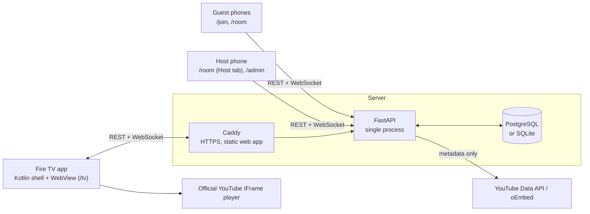

# Architecture

**Core rule:** the server owns the queue, the TV owns playback, phones submit requests and host
commands. The server never touches YouTube video streams.



## Components

### Party server (`services/api`)

| Module | Responsibility |
|---|---|
| `app/services/rooms.py` | The queue and playback state machine. All mutations go through here. |
| `app/routers/*` | HTTP endpoints (`public`, `sessions`, `search`, `tv`, `admin`) and the WebSocket (`ws`). |
| `app/realtime.py` | In-memory WebSocket fan-out per party. |
| `app/youtube.py` | Link parsing, search, metadata lookup, quota budget, short-lived caches. |
| `app/security.py`, `app/deps.py` | Credentials and authorization. |
| `migrations/` | Alembic migrations, applied automatically on startup. |

The API deliberately runs as **one process**. WebSocket membership and per-party locks live in
memory, which keeps the design simple and exact; one process easily serves a party (and many
parties). Scaling out would mean moving fan-out to Postgres `LISTEN/NOTIFY` or Redis.

### Web app (`apps/web`)

A SvelteKit single-page app, built to static files and served by Caddy (or by FastAPI in LAN mode).

| Route | Who | Purpose |
|---|---|---|
| `/join/{code}` | Guest | Enter a name and join |
| `/room/{code}` | Guest / host | Tabs: Search · Queue · My songs · Host (hosts only) |
| `/host/claim#{invite}` | Host | Redeem the host QR shown in the TV menu |
| `/admin`, `/admin/pair` | Owner | Password login, pair TVs, open host controls, end parties |
| `/tv` | Fire TV | Lobby, singer intro, player, menu, error and ended screens |

TypeScript types for API payloads are generated from FastAPI's OpenAPI schema
(`packages/contracts/openapi.json` → `apps/web/src/lib/api/schema.d.ts`) with `make types`.

### Fire TV app (`apps/fire-tv`)

A small Kotlin app that loads `https://<server>/tv` in a WebView and adds what a browser can't:
autoplay without a tap, every remote key forwarded to the page (`window.__tvKey`), screen kept
awake, an offline/retry screen, and a first-run server setup screen. See [fire-tv.md](fire-tv.md).

## Data model

| Table | Key fields |
|---|---|
| `devices` | TV identity: `secret_hash`, `pairing_code`, `paired_at`, `revoked_at` |
| `sessions` (a party) | `join_code`, `status` (lobby/active/ended), settings, playback state (`current_item_id`, `playback_phase`, `playback_generation`, `paused`, `restart_seq`, `position_seconds`), `state_version`, `next_sequence` |
| `participants` | `display_name`, `role` (guest/host), `token_hash`, `removed_at` |
| `queue_items` | `sequence_number` (FIFO), `sort_key` (host overrides), video metadata, `status`, `idempotency_key`, `failure_reason` |
| `playback_events` | Audit log of every transition and host action, with actor and generation |

## Queue rules

- Every request gets the party's next **`sequence_number`** inside a transaction, while holding
  that party's lock. Pending songs play in `sort_key` order, which equals FIFO order unless a host
  explicitly reorders. New requests always go to the end.
- Retries are deduplicated by **idempotency key** (unique per party + participant).
- Guests can cancel only their own pending songs; hosts (and the TV) can remove or reorder any.
- Optional per-guest limit on waiting songs (`max_pending_per_guest`, default unlimited).
- Song titles and thumbnails always come from YouTube metadata looked up by the server. Clients
  send only a video ID.

### Item lifecycle

```
PENDING → PREPARING → PLAYING → COMPLETED
PENDING → CANCELLED                     (guest or host)
PREPARING/PLAYING → FAILED              (TV reports a player error)
PREPARING/PLAYING → SKIPPED             (host)
```

### Party phases

| Phase | Meaning | TV shows |
|---|---|---|
| `idle` | Nothing assigned (lobby, or queue empty) | Lobby with QR code and queue preview |
| `intro` | Next item assigned (`PREPARING`) | "Up next" singer card + countdown, video cued |
| `playing` | TV confirmed playback started | Full-screen video |
| `error` | Item failed and auto-skip is off | Error screen with Skip / Try again |

When the party is `active` and nothing is assigned, the server hands the earliest pending item to
the player immediately (`_maybe_advance`), after any mutation.

## Playback protocol

1. The server assigns the next item and increments **`playback_generation`**, then broadcasts.
2. The TV shows the intro, cues the video, then plays it. When the IFrame player reports
   `PLAYING`, the TV sends `started(item_id, generation)`.
3. Every 5 s the TV sends `progress` over the WebSocket (position, duration, state); phones use it
   for progress bars and wait estimates, and the server stores it so a restarted TV resumes mid-song.
4. On `ENDED` the TV sends `ended(item_id, generation)`; on a player error, `failed(…, error_code)`.
5. The server accepts an event only if `item_id` **and** `generation` match the current
   assignment. A duplicate `ended`, a late event from the previous song, or an event from a
   different TV changes nothing (`accepted: false`). Two `ended` events can never skip two songs.
6. Host commands that target a song (`skip`) can carry `expected_item_id`; if the song changed in
   the meantime the command is rejected, so two hosts pressing Skip at once skip one song.

Pause/resume and restart are **declarative**: the snapshot carries `paused` and `restart_seq`, and
the TV reconciles its player with each snapshot. A reconnecting TV therefore always converges on
the right state without replaying commands.

## Real-time updates

`WS /api/ws`. The first message authenticates (`{"type":"auth","token":…}`); credentials never
appear in URLs or access logs. After that the server pushes:

- `room_state` — the complete party snapshot with a `version`. Clients keep the newest one, so a
  missed message never matters. Snapshots are small (a party has tens of songs).
- `event` — ephemeral notifications for toasts and TV banners (`song_added`, `guest_joined`,
  `track_started`, `track_failed`, `show_join`, …).
- `progress` — playback position from the TV.

Clients ping every 20 s, reconnect with exponential backoff, reconnect immediately when a phone
wakes up, and stop retrying on terminal close codes (`4401` bad credentials, `4403` removed,
`4410` party ended).

## Security

| Credential | Form | Scope |
|---|---|---|
| Guest/host token | Random 256-bit token, stored as SHA-256 | One participant in one party; useless once the party ends |
| TV secret | Random 256-bit token, stored as SHA-256 | One device; revocable from `/admin` |
| Admin token | HMAC-signed, expires (30 days) | Pair TVs, create host identities, end parties |
| Host invite | HMAC-signed, 15 minutes, in the URL fragment | Becomes host of one party |

- A join code lets you *join*; it never grants host rights.
- Host controls require a host participant, the party's TV, or the admin.
- Rate limits: join, lookup, search, link resolve, enqueue, admin login, TV registration.
- Search and link lookup require a party credential, so strangers can't spend the API quota.
- Pasted links are parsed locally and validated against an allow-list of YouTube hosts; the
  server never fetches a URL a user typed.
- The YouTube API key stays on the server.
- Production refuses to start without a strong `SECRET_KEY` and an `ADMIN_PASSWORD`.
- Logs record party IDs, item IDs and actors (truncated IDs), not guest names.
