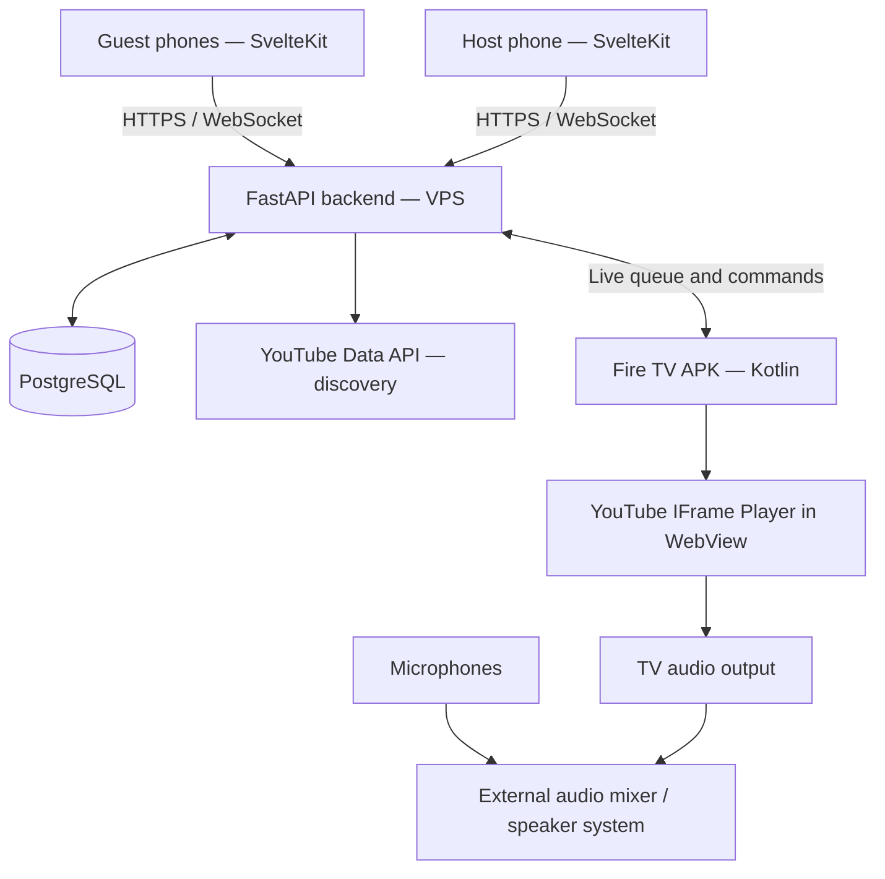

# Karaoke System — Development Plan

**Version:** 1.0  
**Date:** October 11, 2026  
**Target device:** Amazon Fire TV Cube (3rd Generation, 2022)  
**Purpose:** Build a polished, private-party karaoke system where guests queue YouTube karaoke videos from their phones and the Fire TV plays them in order.

---

## 1. Project Vision

Create a professional, dark-themed karaoke lounge experience:

1. The host launches a **native Fire TV APK** on a Fire TV Cube (3rd Gen).
2. The TV displays a **QR code** for guests to join.
3. Guests scan the code, choose a display name, and use a **mobile website**—no app installation or login required.
4. Guests **search YouTube for karaoke versions** or **paste a YouTube URL**, select a result, and add it to a shared queue.
5. Songs play in **first-come, first-served** order on the Fire TV.
6. During playback, the TV briefly shows tasteful **queue notifications**, without obscuring the YouTube player. Between songs, it can show full-screen **next-singer announcements**.
7. The host controls playback using either the **Fire TV remote** or a **secure host dashboard** on their phone.
8. The **cloud VPS** manages sessions, queue state, and real-time synchronization. Video streams directly to the Fire TV from its authorized playback source.
9. Microphones are **mixed externally** with the TV audio through the existing mixer/speaker setup.

### Confirmed requirements

| Area | Decision |
|---|---|
| TV platform | Native Android APK on Fire TV Cube 3rd Gen |
| Joining | Scan on-screen QR code; nickname; no mobile app install |
| Song discovery | YouTube karaoke search **and** pasted YouTube links |
| Playback | Stream using authorized YouTube embedding first; fallback where permissible |
| Host controls | Host phone and Fire TV remote |
| Queue ordering | Strict first come, first served |
| TV layout | Fullscreen karaoke video, brief non-obstructive queue announcements |
| Microphones | Externally mixed into speaker/sound system |
| Backend | Cloud/VPS accessible over the internet |
| Visual theme | Modern, dark, premium karaoke lounge |

### Non-goals for the first release

- Native iOS/Android apps for guests.
- AI vocal removal, pitch scoring, recording, or microphone processing.
- Automatically downloading or caching YouTube audiovisual content.
- Guaranteed ad-free YouTube playback.
- A commercial/public karaoke licensing solution.

---

## 2. Device and Playback Feasibility

### Fire TV Cube (3rd Gen)

The 2022 Fire TV Cube is an **Android-based Fire OS 7** device, making a native Kotlin APK an appropriate target. The app can be sideloaded for private development and testing with Android Debug Bridge (ADB). Its WebView is the initial playback candidate.

**Important:** The Fire TV Cube 3rd Gen should not be confused with newer *Vega OS* Fire TV devices, which cannot run an Android APK natively.

### YouTube integration: preferred approach

- Use the **YouTube IFrame Player API** in an Android `WebView` to stream playable, embeddable videos.
- Use the **YouTube Data API** through the backend to discover videos; support pasted URLs without requiring search.
- Query for likely karaoke results (e.g., `"Dancing Queen ABBA karaoke lyrics"`), then let users choose a specific version.
- Filter for embeddable videos where supported; still handle runtime playback errors.
- Listen for player state changes such as **playing**, **paused**, **ended**, and **error**.
- On `ENDED`, request an authoritative queue advance from the backend and load the next video.
- Test WebView identity/`Referer`, player origin, full-screen behavior, and autoplay restrictions on the **actual Cube** before committing to this approach.

**Policy and reliability boundaries:**

- Standard YouTube Terms and API policies generally prohibit downloading/caching YouTube audiovisual content without permission. **Do not implement an automatic YouTube downloader as a workaround.**
- Preserve required YouTube controls, branding, advertisements, and attribution. Do not put visual overlays over/obstruct the embedded player. Display notification banners in a separate region or announce singers between tracks.
- Ads, playback restrictions, deleted videos, regional restrictions, and unavailable embeds may interrupt the session; show a clear fallback/skip flow.
- Automatic next-video playback in an embedded WebView may be affected by user-interaction/autoplay rules; validate this in Phase 0.
- YouTube's default Data API quota has historically been **10,000 units/day**, while `search.list` costs **100 units per call**—approximately 100 full-cost searches/day before other API consumption. Verify current quota/pricing for the actual Google Cloud project, debounce input, and minimize repeated searches. Do not assume cache retention is unrestricted; follow applicable API data-handling rules.

### Playback fallback

1. **Primary:** Stream an embeddable YouTube karaoke video.
2. **When a particular video fails:** Let the host or guest choose another karaoke upload; provide **Skip**.
3. **Optional later:** Add a separate library of locally stored or licensed karaoke files that you are authorized to play, using Android Media3/ExoPlayer.

Do **not** promise offline YouTube playback or guaranteed no-ad playback.

### Initial feasibility test

Before building the full product, create a simple APK that can:

- Launch on the Cube using ADB.
- Load an official embedded YouTube video in WebView.
- Play, pause, resume, and report player events.
- Successfully play a list of 3–5 karaoke videos sequentially.
- Detect/handle blocked videos and missing embeds.
- Confirm sound output into the external mixer/speakers.

**Go/no-go milestone:** If seamless embedded playback or auto-advance proves unreliable, revisit the playback provider/design before proceeding to the premium interface.

---

## 3. High-Level Architecture



**Core design rule:** The **VPS owns the queue**, the **Fire TV owns playback**, and **phones submit requests/host commands**. The VPS does not proxy or download YouTube video streams.

### Technology stack

| Layer | Technology | Role |
|---|---|---|
| Fire TV application | **Kotlin + Jetpack Compose** | TV UI, remote navigation, player lifecycle |
| YouTube playback | **Android WebView + YouTube IFrame Player API** | Authorized streaming and playback events |
| Optional licensed media | **AndroidX Media3 / ExoPlayer** | Local/authorized media playback later |
| Guest and host interfaces | **SvelteKit + TypeScript** | Responsive, install-free mobile web app |
| Backend API | **Python FastAPI** | Session creation, auth, queue, host commands |
| Real-time communication | **WebSockets** | Synchronize all devices with minimal delay |
| Persistence | **PostgreSQL** | Sessions, guests, queue, state, audit history |
| Reverse proxy and TLS | **Caddy** | HTTPS and WSS termination |
| Deployment | **Docker Compose on VPS** | Simple single-server deployment |
| Video search | **YouTube Data API** | Karaoke discovery and metadata |

For a private party with four guests, a single VPS and PostgreSQL database is plenty. Redis, Kubernetes, and distributed workers are unnecessary for v1.

---

## 4. User Experiences

### A. TV lobby

**When the host opens the APK:**

- Display the room's name, e.g., **Karaoke Night**.
- Show a large, high-contrast **QR code** and short join URL/room code.
- Show guest count and optional rotating welcome text.
- Offer **Start Party** and **Settings** using the remote.
- Allow host pairing with a secure code or host login.

Example invitation URL (placeholder):

`https://karaoke.example.com/join/ABCD12`

### B. Guest mobile flow

1. Scan the TV's QR code.
2. Enter a nickname, e.g., **Jessica**.
3. See three tabs: **Search**, **Queue**, and **My Songs**.
4. Search for `"Mr. Brightside karaoke"`, or paste a YouTube link.
5. View thumbnail, title, channel, approximate duration, and karaoke-version context.
6. Tap **Add to Queue** and get immediate confirmation plus queue position.
7. Watch position change live; cancel an upcoming request they own.

No guest password or account creation is required. Guest tokens should be scoped to one room and one participant.

### C. TV during playback

- Use the video player as the dominant visual element.
- Show a brief **"Added to Queue"** notification in a region outside the embedded player when layout permits.
- Hide secondary controls while a song plays.
- Between songs, show a polished **"Up Next: Jessica — Dancing Queen"** card for a few seconds, then begin playback.
- Gracefully return to the lobby/idle screen if the queue becomes empty.

> **Implementation note:** To preserve YouTube embedding compliance, avoid custom graphics overlapping or concealing the embedded YouTube player. Display queue announcements beside the player, in a reserved region, or during a between-song interstitial.

### D. Host mobile flow

The host has a separate authenticated control dashboard containing:

- **Now Playing** (title, singer, source, playback status).
- **Play/Pause**, **Skip** (confirmation for accidental skips), and **Replay** if feasible.
- **Queue manager** (remove/reorder, though guests see FIFO unless host deliberately intervenes).
- **Show QR**, **Lock Queue**, **End Party**.
- Clear errors and a one-tap **Skip unavailable video** action.

### E. Fire TV remote controls

| Input | Action |
|---|---|
| Center/Select | Play/pause when playback controls are focused |
| Menu | Open the host/control menu |
| Directional pad | Move through TV controls and the queue |
| Back | Close overlays/menus; do not accidentally quit during a song |
| Skip | Dedicated menu action with confirmation |

The Android app must work well with a **D-pad**; no touchscreen should be assumed.

---

## 5. Queue Rules and State Machine

### First-come, first-served behavior

- Each request receives a server-side **monotonically increasing sequence number** inside a database transaction.
- Pending songs are ordered by `(sequence_number ASC)`—**never** by device-local timestamps.
- Guests may add songs whenever joining is open.
- By default, guests can cancel **their own pending** songs only.
- Host can remove, skip, or optionally reorder songs; host actions are recorded.
- Duplicate submissions caused by retries use an **idempotency key**, preventing accidental duplicates.
- If multiple guests submit simultaneously, the database decides one stable queue order.

### Queue item states

`PENDING -> PREPARING -> PLAYING -> COMPLETED`

Exceptional transitions:

- `PENDING -> CANCELLED` (guest or host).
- `PREPARING/PLAYING -> FAILED` (unavailable video/player error).
- `PLAYING -> SKIPPED` (host action).

### Player and backend synchronization

1. API stores an enqueued song, then broadcasts a new queue snapshot/event.
2. If the player is idle, it reserves the earliest pending item as the next track.
3. Fire TV receives an **instruction with track ID and playback generation/version**.
4. Fire TV loads the video and acknowledges the actual playback state.
5. On video end, Fire TV sends `track_ended(track_id, generation)`.
6. Backend confirms the event is current (not duplicated/stale), marks the track completed, and assigns the next song.
7. Fire TV shows the next-singer screen and starts that video.

**Important edge cases:**

- Double `ENDED` event must not skip two songs.
- Reconnection must not play the wrong queued item.
- Remote and phone commands must not conflict; newer authoritative commands win.
- An unplayable video should fail cleanly and permit a manual or configured automatic skip.
- TV sleeping/restarting should allow the host to restore the party.

---

## 6. API and Data Design

### Example endpoints

| Method | Route | Purpose |
|---|---|---|
| `POST` | `/api/sessions` | Create room/session (host-authenticated) |
| `POST` | `/api/sessions/{id}/join` | Join room with nickname |
| `GET` | `/api/search?q=...` | Find YouTube karaoke candidates |
| `POST` | `/api/sessions/{id}/queue` | Add song request |
| `GET` | `/api/sessions/{id}/queue` | Current queue and playback state |
| `DELETE` | `/api/sessions/{id}/queue/{itemId}` | Cancel own pending request or host removal |
| `POST` | `/api/sessions/{id}/commands` | Host controls: pause/play/skip/etc. |
| `POST` | `/api/tv/pair` | Pair TV with room/host |
| `WS` | `/api/sessions/{id}/events` | Live room events |

All mutation endpoints require appropriate room-scoped credentials. Do not assume a room code is sufficient for host authorization.

### Suggested database entities

**`sessions`**
- `id`, `join_code`, `title`, `status`, `created_at`, `ended_at`
- `host_id`, `queue_open`, `current_track_id`, `state_version`

**`participants`**
- `id`, `session_id`, `display_name`, `role`, `joined_at`, `last_seen_at`

**`queue_items`**
- `id`, `session_id`, `participant_id`, `sequence_number`
- `provider`, `provider_video_id`, `title`, `channel`, `duration_seconds`, `thumbnail_url`
- `status`, `idempotency_key`, `requested_at`, `started_at`, `finished_at`

**`devices`**
- `id`, `session_id`, `device_type`, `paired_at`, `last_seen_at`

**`playback_events`**
- `id`, `session_id`, `queue_item_id`, `event_type`, `playback_generation`, `created_at`

**WebSocket events:** `guest_joined`, `queue_updated`, `track_preparing`, `track_started`, `track_ended`, `track_failed`, `playback_paused`, `party_ended`.

Include a version number in all queue/state broadcasts; clients that miss events should request a fresh snapshot.

---

## 7. UI/UX Design System

**Visual direction:** Modern premium karaoke lounge. Understated and cinematic—not a busy neon arcade.

### Color palette

| Token | Hex | Usage |
|---|---|---|
| `background` | `#0B0D12` | Full-screen TV/mobile backdrop |
| `surface` | `#1B1E28` | Cards, menus, overlays |
| `accent` | `#B6A0EF` | Interactive highlights |
| `premium` | `#D4B47A` | Singer announcements and special details |
| `text` | `#F4F1EC` | Primary typography |

### Design principles

- Big, readable **TV-safe** typography visible from a couch.
- Generous negative space and restrained animations.
- Simple karaoke/song artwork thumbnails on mobile.
- Clear active/hover/focus states for Fire TV remote control.
- High-contrast QR code and short join code.
- Subtle transitions: fade, slide, and stagger; avoid slow animations that delay playback.
- Design for a **1920 × 1080 layout** with 4K output scaling and TV-safe margins.
- Phone controls sized for one-handed use; queue placement visible immediately after submitting.

### Core screens to build

**Fire TV:** Lobby, Now Playing, Between-Song Singer Intro, Queue/Settings Menu, Error/Recovering, Empty Queue.

**Guest website:** Join, Search, Results, Song Detail/Confirm, Queue, My Songs, Session Ended.

**Host website:** Host Pair/Login, Now Playing, Queue Management, Playback Controls, Session Settings.

---

## 8. Security and Operational Requirements

- Serve all phone and API traffic through **HTTPS/WSS**.
- Use an authenticated **host token** that is distinct from guest room credentials.
- Use short-lived **guest tokens** scoped to a room; use revocation/expiration after a party.
- Require signed/authorized commands for the Fire TV; never allow guests to issue host commands through public WebSockets.
- Rate-limit joining, song searching, and queue submission.
- Validate that pasted URLs are genuine supported YouTube URLs and extract/normalize video IDs server-side; do not fetch arbitrary pasted URLs.
- Keep YouTube API keys server-side; never embed a privileged Data API key in the APK or guest JavaScript.
- Store secrets in VPS environment/secret configuration, not Git.
- Log critical queue transitions and playback failures with session IDs, excluding unnecessary guest PII.
- Back up PostgreSQL and support migrations.
- Use structured logs, health endpoints, and automatic service restart.

**Deployment:** Start with `docker compose` services for `api`, `web`, `postgres`, and `caddy`. Use a domain/subdomain with HTTPS. Fire TV maintains an outbound connection to the VPS and needs no incoming port forwarding at home.

---

## 9. Development Roadmap

### Phase 0 — Validate YouTube Playback on Fire TV

**Build:** A minimal Kotlin Android project and debug APK, with WebView and official IFrame player support.

**Test:** ADB install, remote input, playback, `ENDED` and `ERROR` events, sequential videos, real mixer audio, and WebView restrictions.

**Done when:** At least 3–5 karaoke videos play sequentially on the Cube and errors can be detected/recovered without manually restarting the APK.

### Phase 1 — Create the Backend

**Build:** FastAPI, PostgreSQL schema, sessions, guest credentials, FIFO queue, host commands, WebSockets, and API tests.

**Test:** Simultaneous requests from four clients, idempotency, authoritative ordering, and invalid/unauthorized commands.

**Done when:** A simulated TV client and four guests can maintain a consistent real-time queue.

### Phase 2 — Build Guest Mobile Web

**Build:** SvelteKit join flow, QR code route, nickname, YouTube search, pasted URL parsing, search results, request submission, and live queue.

**Test:** Safari on iPhone, Chrome on Android, rejoin, bad links, rejected/blocked videos, and network interruptions.

**Done when:** Someone unfamiliar with the system can scan, join, and request a song without instructions.

### Phase 3 — Integrate Fire TV and Host Controls

**Build:** TV pairing, playback state protocol, queue auto-advance, singer interstitials, remote controls, and authenticated host phone UI.

**Test:** Pause, skip, track error, no queue, reconnect, duplicate `ENDED`, and multi-device host actions.

**Done when:** A realistic multiguest session plays songs correctly in strict FIFO order.

### Phase 4 — Premium Visual Polish

**Build:** Dark-lounge design system, smooth animations, high-quality lobby, singer intros, polished mobile pages, transitions, and consistent error screens.

**Done when:** All primary guest, host, and TV screens feel coherent and professionally designed.

### Phase 5 — Reliability and Release

**Build:** Logging, safe reconnect logic, deployment scripts, back-up/restore, APK packaging, update instructions, and system documentation.

**Test:** Long party session, internet loss, unavailable video, Fire TV app restart, host disconnect, duplicate queue submission, and audio path.

**Done when:** A complete party simulation on the actual Fire TV Cube works with minimal intervention.

---

## 10. Suggested Monorepo

```text
karaoke-system/
├── apps/
│   ├── fire-tv/              # Kotlin Fire OS / Android TV APK
│   └── web/                  # SvelteKit guest and host website
├── services/
│   └── api/                  # FastAPI application
│       ├── app/
│       ├── migrations/
│       └── tests/
├── packages/
│   └── contracts/            # Shared OpenAPI/TypeScript client types
├── infrastructure/
│   ├── compose.yaml
│   └── Caddyfile
├── docs/
│   ├── architecture.md
│   ├── youtube-feasibility.md
│   └── deployment.md
├── tests/
│   ├── queue/
│   └── integration/
└── README.md
```

### Suggested build sequence for a coding agent

1. Scaffold the monorepo and documentation.
2. Build **only Phase 0**, install the APK on the Cube, and verify playback behavior.
3. Record findings, especially YouTube embed failures and autoplay edge cases.
4. Implement the backend and queue tests.
5. Implement the guest phone interface and host dashboard.
6. Integrate the Fire TV APK with WebSocket state and commands.
7. Polish UI/UX and harden reliability.

Do not spend significant effort on complex visual UI until the Phase 0 playback approach is proven.

---

## 11. MVP Acceptance Checklist

- [ ] Fire TV Cube installs and launches the APK.
- [ ] Fire TV displays a scannable QR code and room code.
- [ ] Four or more guests can join from phones with nicknames and no install.
- [ ] Guests can search for karaoke videos and paste a supported YouTube link.
- [ ] Requests are ordered using authoritative server-side FIFO sequence numbers.
- [ ] The queue synchronizes live across TV and phones.
- [ ] Only the host can pause/skip/end the party; guests can cancel their own pending songs.
- [ ] The Fire TV plays an embeddable video with sound routed into the mixer.
- [ ] Finishing a track safely advances to the next queued song.
- [ ] Duplicate playback events cannot skip songs.
- [ ] Unavailable videos show recoverable errors instead of freezing the session.
- [ ] Singer announcements appear between songs; in-player YouTube content remains unobstructed.
- [ ] Basic reconnection works after temporary loss of the VPS connection.
- [ ] The dark lounge UI is readable and navigable with the Fire TV remote.
- [ ] The system does not automatically download YouTube media.

---

## 12. Key Decisions to Revisit After Prototype

1. **Can the official YouTube player reliably auto-advance on this Cube?** If not, choose a supported alternative before building the full experience.
2. **How should ads be handled?** They cannot be removed or bypassed through the official YouTube embed integration.
3. **Should guests be limited to a certain number of pending requests?** Default to no cap for v1; make configurable later if needed.
4. **Should the host be able to manually reorder tracks?** Recommend yes, as an explicit override, while guest submissions remain FIFO.
5. **Will you need licensed local video playback?** Defer until after the YouTube-based MVP is working.
6. **Do you want the experience to work if the VPS is offline?** Keep v1 cloud-dependent; evaluate local fallback only if needed.

### Bottom Line

**Start with a minimal Kotlin playback prototype on the actual Fire TV Cube (3rd Gen).** Then build a FastAPI-owned queue, SvelteKit mobile guest/host interfaces, and a premium dark-lounge Fire TV experience around the validated playback method. This order minimizes risk and gets a working party system in place before investing in visual polish.

---

## Reference Documentation

Official documentation to review during implementation:

- [Amazon: Fire TV device specifications](https://developer.amazon.com/docs/fire-tv/device-specifications.html)
- [Amazon: Connect to Fire TV through ADB](https://developer.amazon.com/docs/fire-tv/connecting-adb-to-device.html)
- [YouTube IFrame Player API](https://developers.google.com/youtube/iframe_api_reference)
- [YouTube Data API `search.list`](https://developers.google.com/youtube/v3/docs/search/list)
- [YouTube API Services Policies](https://developers.google.com/youtube/terms/developer-policies)
- [YouTube API Quota Costs](https://developers.google.com/youtube/v3/determine_quota_cost)
- [Android WebView](https://developer.android.com/develop/ui/views/layout/webapps/webview)
- [Android Media3](https://developer.android.com/media/media3)
- [FastAPI](https://fastapi.tiangolo.com/)
- [SvelteKit](https://svelte.dev/docs/kit/introduction)

*Documentation links are provided for implementation reference; exact API policies, quotas, and Fire TV platform behavior should be checked during Phase 0.*
